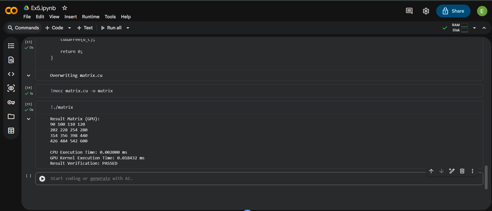

# PCA-EXP-5-MATRIX-MULTIPLICATION-USING-CUDA-AY-23-24
<h3>AIM:</h3>
<h3>ENTER YOUR NAME : ESWAR S</h3>
<h3>ENTER YOUR REGISTER NO : 212225230067</h3>
<h3>EX. NO : 5</h3>
<h3>DATE : 24.11.2026</h3>

---

<h1> <align=center> MATRIX MULTIPLICATION USING CUDA </h3>
  Implement Matrix Multiplication using GPU.</h3>

## AIM:
To perform Matrix Multiplication using CUDA and check its performance with nvprof.
## EQUIPMENTS REQUIRED:
Hardware – PCs with NVIDIA GPU & CUDA NVCC
Google Colab with NVCC Compiler
## PROCEDURE:
1.	Define Constants: Define the size of the matrices (SIZE) and the size of the CUDA blocks (BLOCK_SIZE).
2.	Kernel Function: Define a CUDA kernel function matrixMultiply that performs the matrix multiplication.
3.	In the main function, perform the following steps:
4.	Initialize Matrices: Initialize the input matrices ‘a’ and ‘b’ with some values.
5.	Allocate Device Memory: Allocate memory on the GPU for the input matrices ‘a’ and ‘b’, and the output matrix ‘c’.
6.	Copy Matrices to Device: Copy the input matrices from host (CPU) memory to device (GPU) memory.
7.	Set Grid and Block Sizes: Set the grid and block sizes for the CUDA kernel launch.
8.	Start Timer: Start a timer to measure the execution time of the kernel.
9.	Launch Kernel: Launch the matrixMultiply kernel with the appropriate grid and block sizes, and the input and output matrices as arguments.
10.	Copy Result to Host: After the kernel execution, copy the result matrix from device memory to host memory.
11.	Stop Timer: Stop the timer and calculate the elapsed time.
12.	Print Result: Print the result matrix and the elapsed time.
13.	Free Device Memory: Finally, free the device memory that was allocated for the matrices.
## PROGRAM:
```

%%writefile matrix.cu
#include <stdio.h>
#include <cuda_runtime.h>
#include <time.h>

#define N 4

__global__ void multiply(int *A,int *B,int *C)
{
    int row=threadIdx.y+blockIdx.y*blockDim.y;
    int col=threadIdx.x+blockIdx.x*blockDim.x;

    if(row<N && col<N)
    {
        int sum=0;
        for(int k=0;k<N;k++)
            sum+=A[row*N+k]*B[k*N+col];
        C[row*N+col]=sum;
    }
}

int main()
{
    int A[N][N]={{1,2,3,4},{5,6,7,8},
                 {9,10,11,12},{13,14,15,16}};

    int B[N][N]={{1,2,3,4},{5,6,7,8},
                 {9,10,11,12},{13,14,15,16}};

    int C_CPU[N][N],C_GPU[N][N];

    // CPU Matrix Multiplication
    clock_t cpu_start=clock();

    for(int i=0;i<N;i++)
    {
        for(int j=0;j<N;j++)
        {
            C_CPU[i][j]=0;
            for(int k=0;k<N;k++)
                C_CPU[i][j]+=A[i][k]*B[k][j];
        }
    }

    clock_t cpu_end=clock();

    double cpu_time=(double)(cpu_end-cpu_start)
                    /CLOCKS_PER_SEC*1000.0;

    // GPU Memory Allocation
    int *d_A,*d_B,*d_C;

    cudaMalloc(&d_A,sizeof(A));
    cudaMalloc(&d_B,sizeof(B));
    cudaMalloc(&d_C,sizeof(C_GPU));

    cudaMemcpy(d_A,A,sizeof(A),cudaMemcpyHostToDevice);
    cudaMemcpy(d_B,B,sizeof(B),cudaMemcpyHostToDevice);

    dim3 threads(16,16);
    dim3 blocks(1,1);

    // GPU Timing
    cudaEvent_t start,stop;
    cudaEventCreate(&start);
    cudaEventCreate(&stop);

    // Warm-up
    multiply<<<blocks,threads>>>(d_A,d_B,d_C);
    cudaDeviceSynchronize();

    cudaEventRecord(start);
    multiply<<<blocks,threads>>>(d_A,d_B,d_C);
    cudaEventRecord(stop);
    cudaEventSynchronize(stop);

    float gpu_time=0;
    cudaEventElapsedTime(&gpu_time,start,stop);

    cudaMemcpy(C_GPU,d_C,sizeof(C_GPU),cudaMemcpyDeviceToHost);

    // Display Result
    printf("Result Matrix (GPU):\n");

    for(int i=0;i<N;i++)
    {
        for(int j=0;j<N;j++)
            printf("%d ",C_GPU[i][j]);
        printf("\n");
    }

    // Verification
    int correct=1;

    for(int i=0;i<N;i++)
        for(int j=0;j<N;j++)
            if(C_CPU[i][j]!=C_GPU[i][j])
                correct=0;

    printf("\nCPU Execution Time: %.6f ms\n",cpu_time);
    printf("GPU Kernel Execution Time: %.6f ms\n",gpu_time);
    printf("Result Verification: %s\n",correct?"PASSED":"FAILED");

    cudaEventDestroy(start);
    cudaEventDestroy(stop);

    cudaFree(d_A);
    cudaFree(d_B);
    cudaFree(d_C);

    return 0;
}

```

## OUTPUT:


## RESULT:
Thus the program has been executed by using CUDA to mulptiply two matrices. It is observed that there are variations in host and device elapsed time. Device took 0.018432 ms time and host took 0.002000 ms time.